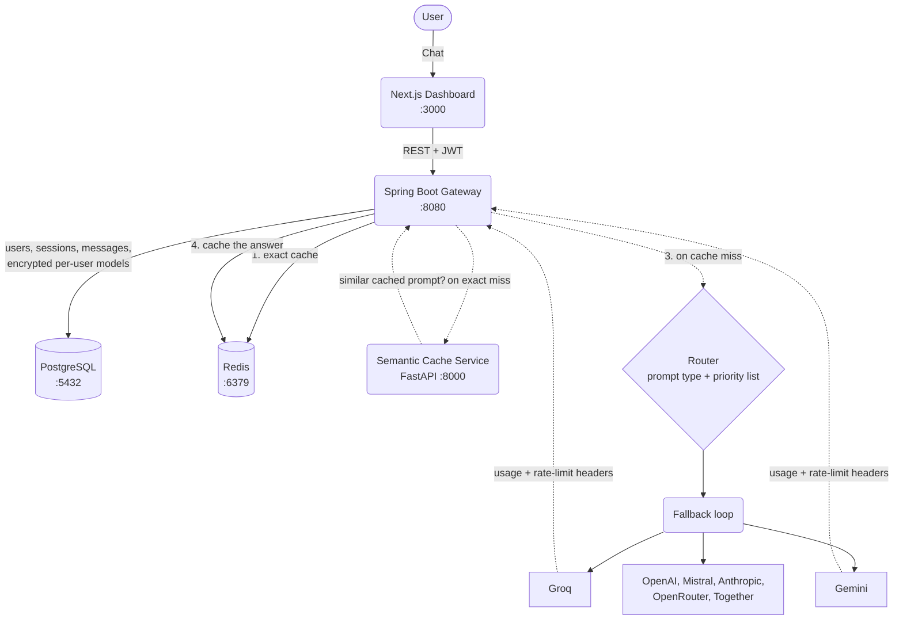

# diplomatAI: Multi-LLM Gateway


A gateway that gives applications one API for several LLM providers. When a provider rate-limits or fails, the request moves to another model, and repeated or reworded prompts are answered from a cache. Each user has their own account, chat history and encrypted provider API keys.

It also includes a Next.js chat dashboard with a metrics panel showing which model answered, cache hits, fallbacks, latency, and per-provider token usage and rate-limit headroom.

> Built to learn how LLM gateways work. Mature products in this space exist (LiteLLM, Portkey, OpenRouter); see [Limitations](#limitations) for what this one does and does not do.

---

## Features

| Area | What it does |
|------|--------------|
| **Failover** | If a call fails or hits a rate limit, the gateway retries on the next best model the user has registered. Resilience4j provides a gateway-wide rate limiter and a circuit breaker per user and model, so a failing model stops being called without affecting others. |
| **Routing** | Prompts are classified by keyword as coding, quick question or general, then sent to the first available provider on that category's priority list. Users can also pin a specific model. |
| **Caching** | Exact matches come from Redis. On a miss, a separate FastAPI service uses sentence-transformers (cosine similarity above 0.80) to find a reworded match. A cache hit skips the provider call entirely. See [Caching rules](#caching-rules). |
| **Accounts** | JWT login (BCrypt password hashes). Chat sessions and messages are stored in PostgreSQL, so history follows the user across devices. |
| **Per-user API keys** | Provider keys are validated against the provider, encrypted at rest (AES-GCM), and used only to route that user's own requests. The API only ever returns a masked hint. |
| **Provider adapters** | One request format is translated into the OpenAI-style, Gemini and Anthropic payloads. Token usage and rate-limit headers are read from each response. |
| **Dashboard** | Next.js UI with sign-in, chat history, markdown and code rendering, a model picker, cache controls, and the metrics panel. |

---

## Architecture



### How a request flows
1. The dashboard (or any client) sends `POST /api/v1/chat` with a JWT.
2. The gateway loads the caller's own registered models, then checks the cache. Only a standalone first-turn prompt is eligible.
3. On a miss it picks a model (the pinned one, or by prompt type), calls the provider, and on failure retries the next best model.
4. The answer is cached (when eligible), saved to the user's chat session, and returned with metrics.

---

## Supported Providers

| Provider | Free Tier | Key validation endpoint |
|----------|-----------|-------------------------|
| OpenAI | $5 credit on sign-up | `api.openai.com/v1/models` |
| Gemini | Free tier available | `generativelanguage.googleapis.com` |
| Anthropic | No free tier | `api.anthropic.com/v1/models` |
| Groq | Free tier available | `api.groq.com/openai/v1/models` |
| Mistral | Limited free tier | `api.mistral.ai/v1/models` |
| OpenRouter | Free models | `openrouter.ai/api/v1/models` |
| Together AI | $5 free credit | `api.together.xyz/v1/models` |

Free-tier limits change; check each provider. Keys are validated against the provider's real endpoint before models are registered.

---

## Quick Start

### Prerequisites
- [Docker & Docker Compose](https://www.docker.com/products/docker-desktop/)
- Git

### Run
```bash
git clone https://github.com/mihir-rathod/diplomatAI.git
cd diplomatAI
docker compose up --build -d
```

Then open `http://localhost:3000`, choose **Create Account**, pick a provider in the right sidebar, paste your API key, and start chatting.

### Services
| Service | URL |
|---------|-----|
| Dashboard | `http://localhost:3000` |
| Gateway API | `http://localhost:8080/api/v1` |
| Semantic cache service | `http://localhost:8000` |
| PostgreSQL | `localhost:5432` |
| Redis | `localhost:6379` |

### Configuration
Defaults in `docker-compose.yml` work for local development. See `.env.example`.

| Variable | Purpose | Default |
|----------|---------|---------|
| `JWT_SECRET` | Signs login tokens (min. 32 chars) | dev placeholder |
| `API_KEY_ENCRYPTION_SECRET` | Encrypts provider API keys in PostgreSQL | dev placeholder |
| `LLM_RATE_LIMIT_PER_MINUTE` | Gateway-wide cap on model calls per minute (set to 5 to demo rate-limit fallback) | `60` |
| `SPRING_DATASOURCE_*` | PostgreSQL connection | set in compose |
| `QC_SERVICE_URL` | Semantic cache service URL | `http://quality-check:8000` |

**Change both secrets before any real deployment.** The defaults are public in this repository.

---

## API Reference

Every endpoint except `/auth/*` and `GET /chat/health` requires `Authorization: Bearer <token>`. Missing or expired tokens return `401`.

### Auth
```
POST /api/v1/auth/register   { "email", "password" (min 8 chars) } -> { "token", "user" }   409 if the email exists
POST /api/v1/auth/login      { "email", "password" }               -> { "token", "user" }   401 on bad credentials
GET  /api/v1/auth/me                                               -> { "id", "email" }
```

### Chat
```
POST /api/v1/chat
Body: {
  "prompt": "your question",
  "modelId": "auto",                       // or a registered model id
  "useCache": true,
  "sessionId": 12,                         // optional: saves the turn to this chat session
  "messages": [{ "role": "user", "content": "..." }]   // full conversation incl. the new prompt
}
Returns: {
  "answer": "...",
  "metrics": {
    "cache_hit", "model_routed", "fallback_triggered", "original_model", "provider",
    "latency_ms", "semantic_similarity", "rate_limit_max", "rate_limit_remaining",
    "prompt_tokens", "completion_tokens", "total_tokens"
  }
}
```

### Chat sessions
```
GET    /api/v1/sessions                    List my sessions
POST   /api/v1/sessions                    Create { "title" }
PATCH  /api/v1/sessions/{id}               Rename { "title" }
DELETE /api/v1/sessions/{id}               Delete a session and its messages
GET    /api/v1/sessions/{id}/messages      Message history for a session
```
Sessions belong to their owner; another user gets `404`.

### My models
```
POST   /api/v1/chat/models                 { "provider": "Groq", "apiKey": "..." } -> registered models (401 if the key is invalid)
GET    /api/v1/chat/models/registry        My registered models (masked key hint only)
DELETE /api/v1/chat/models/registry/{id}   Remove one of my models (ids may contain "/" and ":")
DELETE /api/v1/chat/cache                  Clear my cached answers (other users' caches are untouched)
```

### Health
```
GET /api/v1/chat/health   Gateway status + Redis connectivity (public)
GET /health               Semantic cache service status (on :8000)
```

### Using it from code
```python
import requests
base = "http://localhost:8080/api/v1"
token = requests.post(f"{base}/auth/login", json={"email": "me@example.com", "password": "..."}).json()["token"]
reply = requests.post(f"{base}/chat",
                      headers={"Authorization": f"Bearer {token}"},
                      json={"prompt": "Explain CORS in two sentences"}).json()
print(reply["answer"], reply["metrics"]["model_routed"])
```

---

## Caching rules

- **Scoped per user and per selected model.** One account is never served another account's cached answer, and a pinned model is never answered with a different model's cached reply.
- **Only standalone first-turn prompts are cached.** A follow-up like "explain more" only makes sense given the earlier turns, so it is neither read from nor written to the cache.
- **Never cached:** error responses, and the gateway's own "no models are registered" fallback message.
- Entries expire after 1 hour. The semantic search considers up to 200 of the user's most recent cached prompts.
- Cache hits are saved to the chat history like any other turn.

---

## Testing

The end-to-end suite runs against the real stack. It needs no provider API keys: it starts a mock OpenAI-compatible provider on the host and registers models that point at it.

```bash
LLM_RATE_LIMIT_PER_MINUTE=1000 docker compose up --build -d
cd tests/e2e
uv run --with-requirements requirements.txt pytest -v
```

It covers authentication, session isolation between users, per-user encrypted keys, cache scoping and conversation-awareness, semantic cache hits, routing by prompt type, failover, and surfaced rate-limit headers.

Notes:
- The gateway container reaches the mock provider at `host.docker.internal:18080`. On Linux, add `extra_hosts: ["host.docker.internal:host-gateway"]` to the gateway service or set `MOCK_PROVIDER_HOST`.
- The tests use `docker exec` on the `diplomat-postgres` container to register mock models, and delete their `e2e-*@e2e.test` users afterwards.
- A run makes about 45 model calls in a few seconds, which is why the command above raises `LLM_RATE_LIMIT_PER_MINUTE`. With the default of 60, a second run within the same minute hits the limit and some tests fail.

---

## Project Structure

```
diplomatAI/
├── dashboard/                  # Chat UI (Next.js 16, React 19)
│   ├── app/                    # Chat page, login page, layout
│   ├── components/             # LeftSidebar (history, account), RightSidebar (keys, metrics), ChatWindow, ChatInput
│   └── lib/api.js              # Authenticated fetch + sessions/messages API helpers
├── gateway-service/            # Gateway API (Java 21 / Spring Boot 4)
│   └── src/main/java/com/diplomat/gateway/
│       ├── controller/         # Chat, auth, sessions, messages
│       ├── client/             # Provider calls and rate-limit header extraction
│       ├── service/            # Routing, provider model fetching
│       ├── security/           # JWT, Spring Security config, API-key encryption
│       ├── model/ repository/  # JPA entities (User, Session, Message, RegisteredModel)
│       └── config/             # Default fallback model, per-request model registry
├── quality-check-service/      # Semantic cache matching (Python / FastAPI)
├── tests/e2e/                  # End-to-end test suite (pytest)
├── docker-compose.yml
└── README.md
```

---

## Limitations

- **Routing is simple.** It is keyword matching (substring-based, so short keywords can match inside longer words) plus a fixed provider priority list. Model capabilities and cost are not considered.
- **Model lists are fixed.** Each provider registers two predefined models; the provider's model catalogue is not fetched.
- **The rate limiter is gateway-wide.** It caps total model calls per minute across all users (`LLM_RATE_LIMIT_PER_MINUTE`), not per user or provider. Circuit breakers are per user and model, so one failing model only blocks itself.
- **No streaming.** Responses arrive whole.
- **Conversation context comes from the client.** The dashboard sends the full message history with each request; the server does not rebuild context from stored messages or trim it.
- **No response validation.** The semantic cache service has a prompt/answer relevance endpoint (`/api/v1/validate`), but the gateway does not call it.
- **Not benchmarked.** Cache and failover behavior is tested for correctness; there are no latency or cost measurements.
- **Development defaults.** Secrets and database credentials in `docker-compose.yml` are placeholders for local use only.
